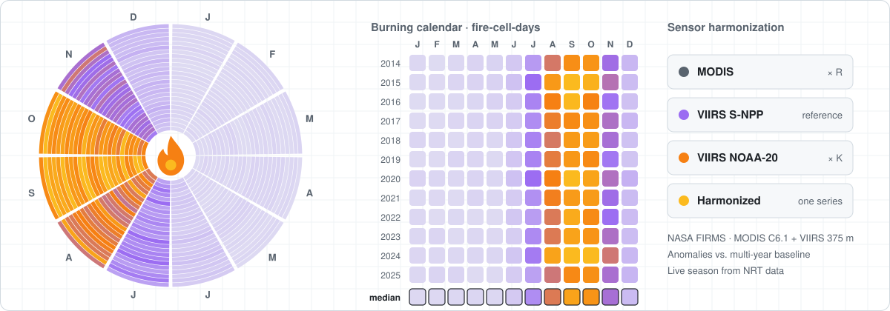
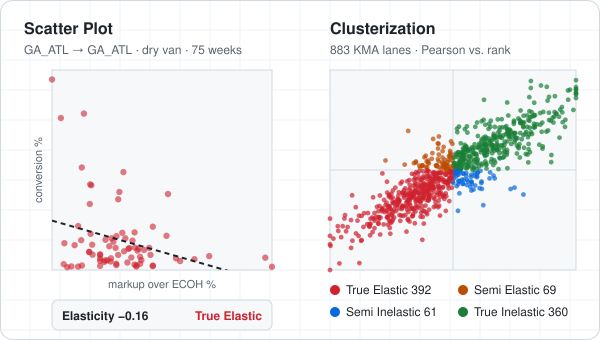
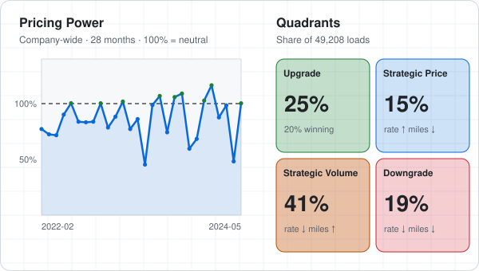
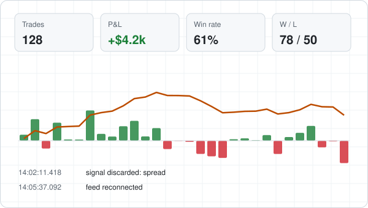
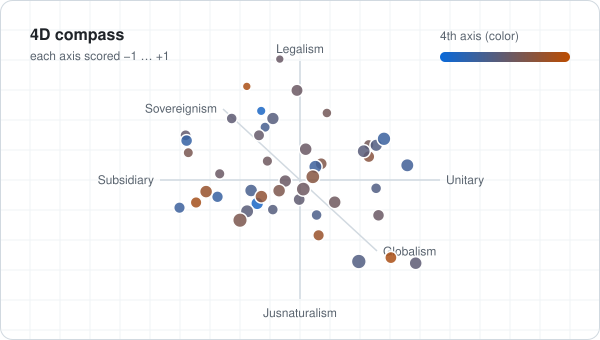
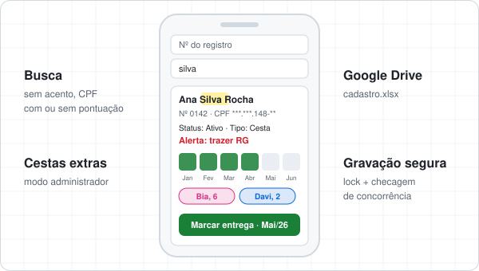
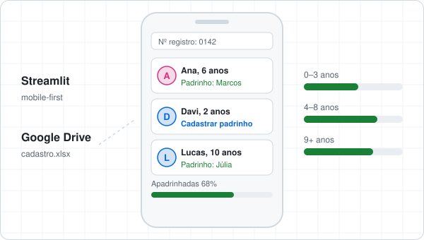

<picture>
  <source media="(prefers-color-scheme: dark)" srcset="assets/banner-dark.svg">
  <source media="(prefers-color-scheme: light)" srcset="assets/banner-light.svg">
  
</picture>

  
  
  
  

I'm a senior data analytics professional with more than ten years turning data into pricing, revenue and planning decisions, across technology, logistics, energy, digital identity and mobility. I build the whole chain: ingestion, ETL/ELT pipelines, data models, KPI frameworks, forecasting and ML-backed pricing, and the dashboards leadership uses to decide. I hold a B.Eng. in Electrical Engineering from Universidade Anhembi Morumbi and studied Corporate Finance & Investment Banking at FIA. On the side I write Python: dashboards, data tools, and lately science.

### Now

- **LatAm Senior Business Intelligence at Thermo Fisher Scientific.**
- **AI Trainer at micro1.** Designing business scenarios (financial workbooks, cases, executive deliverables) to train and evaluate LLMs.
- **[Prime Radiant](https://primeradiant.zenus.systems).** The science core of a NASA FIRMS fire-activity app, built with [Guilherme Zeni](https://github.com/Guillhermm).
- **[Solaria](https://solaria.zenus.systems).** A web app for exploring very large NASA images in the browser: guided Journeys, deep zoom, comparisons and multi-band views, with [Guilherme Zeni](https://github.com/Guillhermm).

### Highlights

<a href="https://primeradiant.zenus.systems">
  <picture>
    <source media="(prefers-color-scheme: dark)" srcset="assets/projects/prime-radiant-dark.svg">
    <source media="(prefers-color-scheme: light)" srcset="assets/projects/prime-radiant-light.svg">
    
  </picture>
</a>

**[Prime Radiant](https://primeradiant.zenus.systems)** · NASA Space Apps Challenge 2026 · with [Guilherme Zeni](https://github.com/Guillhermm)

Harmonizes MODIS and VIIRS active-fire detections from NASA FIRMS into one burning-activity calendar per area, worldwide. I own the `core/` science track:

- **Harmonization:** fire-cell-days per month, MODIS scaled to VIIRS-equivalent with a ratio R, and NOAA-20 continuing S-NPP with a factor K.
- **Baseline and anomalies:** a median multi-year baseline, percentile ranks, flagged periods and year rank.
- **Validation:** each piece passed a written science gate before it shipped to the app.

<a href="https://primeradiant.zenus.systems">Open the app</a> · <a href="https://github.com/Guillhermm/prime-radiant">Source</a>

 

<a href="https://solaria.zenus.systems">
  <picture>
    <source media="(prefers-color-scheme: dark)" srcset="assets/projects/solaria-dark.svg">
    <source media="(prefers-color-scheme: light)" srcset="assets/projects/solaria-light.svg">
    
  </picture>
</a>

**[Solaria](https://solaria.zenus.systems)** · NASA Space Apps Challenge 2025, "Embiggen Your Eyes!" · with [Guilherme Zeni](https://github.com/Guillhermm)

A web app for exploring very large NASA images in the browser: deep zoom over tile pyramids, guided Journeys, before-and-after comparisons and multi-band views of Hubble, HiRISE and SDO imagery. My part, during the challenge:

- **Front-end requirements:** wrote the spec for the viewer: deep-zoom navigation, annotations, layer overlays, temporal comparison and search.
- **Viewer prototype:** built the first zoomable viewer in React, with a minimap, flag markers on the image and a fullscreen mode.

<a href="https://solaria.zenus.systems">Open the app</a> · <a href="https://github.com/Guillhermm/solaria">Source</a>

### Projects

<table>
  <tr>
    <td width="50%" valign="top">
      <a href="https://github.com/kauemelo01/elasticity-wsb"><picture>
        <source media="(prefers-color-scheme: dark)" srcset="assets/projects/elasticity-wsb-dark.svg">
        
      </picture></a>
       <b><a href="https://github.com/kauemelo01/elasticity-wsb">Elasticity &amp; WSB</a></b>
       Power BI model that scores how price-sensitive each truckload lane of a US freight brokerage is, clusters lanes from True Elastic to True Inelastic, and benchmarks them against SONAR and DAT with a Window / Shadow / Blind framework.
    </td>
    <td width="50%" valign="top">
      <a href="https://github.com/kauemelo01/Pricing-Power"><picture>
        <source media="(prefers-color-scheme: dark)" srcset="assets/projects/pricing-power-dark.svg">
        
      </picture></a>
       <b><a href="https://github.com/kauemelo01/Pricing-Power">Pricing Power</a></b>
       Power BI model that splits each month's freight bookings growth into a price effect and a volume effect, places every lane in one of four quadrants, and rolls them up into one load-weighted Pricing Power score.
    </td>
  </tr>
  <tr>
    <td width="50%" valign="top">
      <a href="https://github.com/kauemelo01/Trade-Viz"><picture>
        <source media="(prefers-color-scheme: dark)" srcset="assets/projects/trade-viz-dark.svg">
        
      </picture></a>
       <b><a href="https://github.com/kauemelo01/Trade-Viz">Trade-Viz</a></b>
       Streamlit dashboard that pulls a trading bot's log over SFTP and shows P&amp;L, win rate and order latency in real time.
    </td>
    <td width="50%" valign="top">
      <a href="https://github.com/kauemelo01/Political-Compass"><picture>
        <source media="(prefers-color-scheme: dark)" srcset="assets/projects/political-compass-dark.svg">
        
      </picture></a>
       <b><a href="https://github.com/kauemelo01/Political-Compass">4D Political Compass</a></b>
       A dataset of ideologies and schools of thought, scored on four independent axes and plotted as a 4D scatterplot.
    </td>
  </tr>
  <tr>
    <td width="50%" valign="top">
      <a href="https://github.com/kauemelo01/Cadastro-PS-PSB"><picture>
        <source media="(prefers-color-scheme: dark)" srcset="assets/projects/cadastro-dark.svg">
        
      </picture></a>
       <b><a href="https://github.com/kauemelo01/Cadastro-PS-PSB">Pastoral Social Registry</a></b>
       Mobile-first Streamlit app for a community charity's front desk: accent- and CPF-tolerant search, monthly food-basket delivery tracking and an admin mode, with safe concurrent writes to a spreadsheet on Google Drive.
    </td>
    <td width="50%" valign="top">
      <a href="https://github.com/kauemelo01/Padrinhos-PS-PSB"><picture>
        <source media="(prefers-color-scheme: dark)" srcset="assets/projects/padrinhos-dark.svg">
        
      </picture></a>
       <b><a href="https://github.com/kauemelo01/Padrinhos-PS-PSB">Pastoral Social Sponsorships</a></b>
       Mobile-first Streamlit app that matches sponsors to children at a community charity, backed by a Google Drive spreadsheet.
    </td>
  </tr>
</table>

### Experience

- **Uber (2026).** Launched the Multi Product Surge dynamic-pricing algorithm across LatAm; automated ingestion pipelines and KPI reporting.
- **Loadsmart (2022–2025).** Led the Reliable Contracts program: pricing optimization and forecasting in Python, over US$0.6M/month in commercial impact.
- **idwall (2021–2022).** Chaired the Pricing Committee; analytics-driven pricing worth R$0.3M/month.
- **Schneider Electric (2013–2020).** Margin optimization models worth €1.9M/year; FP&amp;A, pricing and C-level reporting across South America.

Certified Pricing Professional (CPP) · Portuguese (native) · English (C1, Cambridge CPE) · Spanish (professional)

### Toolkit

  
  
  
  
  
  

  
  
  
  
  
  
  
  

